# Uday partner user flows

Source: whiteboard "Uday partner flows" (https://claude.ai/artifact/SpqoRb9ZBSzrNRYB4avPHJ), exported 17 November 2026. The board is the working copy; this file is a snapshot. Raw board data: `partner-flows-board.json`.

Uday is for all of India. Pune is the first city, never the only one.

Colours: blue = Uday team, peach = partner staff, green = family or employee, yellow = senior, white = decision.

## Senior living communities

```mermaid
flowchart TD
  e9["1. First meeting: Uday meets the developer or community manager"]
  class e9 uday
  e10["2. Pilot agreement: One tower, 90 days: data terms, pricing, revenue share"]
  class e10 partner
  e11["3. Admin page set up: Uday creates the community admin page and invites its staff"]
  class e11 uday
  e12["4. Residents added: Staff upload the resident list by Excel"]
  class e12 partner
  e63["5. Onsite staff added: Nurses and caregivers living onsite, by Excel; tagged Community staff"]
  class e63 partner
  e64["6. Nearby hospitals added: Address, emergency number and distance; shown on every alert"]
  class e64 partner
  e13["7. Invitations: Each resident and family gets an SMS in their language"]
  class e13 uday
  e14["8. Senior agrees: Consents and picks a check in time; app or phone call"]
  class e14 senior
  e15["9. Family joins: Adds emergency contacts, wherever they live"]
  class e15 family
  e16["10. Daily check in: One tap or a phone call each morning"]
  class e16 senior
  e17["11. Alert: Onsite staff respond first, nearest hospital shown; then family and Uday"]
  class e17 partner
  e65["12. Safety notice: Admin flags a person not to be let in; residents, families and the gate are told"]
  class e65 partner
  e18["13. Care request: By the family, or by community staff for the resident"]
  class e18 family
  e66{"14. Who gives care?"}
  class e66 decision
  e67["Community staff: Badge says Community staff. Community sets the rate and is paid"]
  class e67 partner
  e69["Revenue ledger: Every booking tagged by source, live on the admin page"]
  class e69 uday
  e19["15. Monthly statement: Hours, fees and share per booking; invoices and payout"]
  class e19 uday
  e20["16. Pilot review: Expand to every tower, change, or stop"]
  class e20 partner
  e68["Uday caregiver: Badge says Uday verified. Uday rate; community earns a share"]
  class e68 uday
  e11 --> e12
  e66 --> e67
  e15 --> e16
  e13 --> e14
  e68 --> e69
  e64 --> e13
  e10 --> e11
  e65 --> e18
  e12 --> e63
  e14 --> e15
  e69 --> e19
  e67 --> e69
  e19 --> e20
  e16 --> e17
  e17 --> e65
  e66 --> e68
  e9 --> e10
  e63 --> e64
  e18 --> e66
  classDef uday fill:#cfe0ff,stroke:#3a5bb8
  classDef partner fill:#ffdcc2,stroke:#c46a2b
  classDef family fill:#d4f2d9,stroke:#2e8b57
  classDef senior fill:#fff3b0,stroke:#b59b00
  classDef decision fill:#ffffff,stroke:#555
```

### Revenue share (assumptions to agree in the pilot)

| Booking source | Caregiver is paid | Uday earns | Community earns | Shown in |
|---|---|---|---|---|
| Uday caregiver | Uday rate, weekly by Uday | 8% platform fee | Share of Uday's fee, e.g. 15% | Ledger and statement |
| Community staff | Community rate, paid to the community | Booking fee, e.g. 3 to 5% | Care fee less Uday's fee | Ledger and statement |
| Daily check in | Not applicable | Per resident fee | Optional discount | Monthly invoice |

## Corporates: a benefit for employees' parents

```mermaid
flowchart TD
  e33["1. HR signs up: Master agreement; pilot with 100 to 500 employees"]
  class e33 partner
  e34["2. Data review: HR never sees a parent's health or alerts"]
  class e34 uday
  e35["3. Eligibility: HR uploads the employee list or approves the email domain"]
  class e35 partner
  e36["4. Launch: Intranet page, webinar and FAQ for employees"]
  class e36 partner
  e37["5. Employee enrols: Work email, then adds a parent anywhere in India"]
  class e37 family
  e38["6. Parent agrees: On their own phone; nothing starts without consent"]
  class e38 senior
  e39["7. Daily check in: Works in every city, in their language"]
  class e39 senior
  e40["8. Alerts: To the employee and family; Uday team escalates"]
  class e40 family
  e41["9. Care booked: Uday caregivers where live; vetted partner agencies elsewhere"]
  class e41 family
  e42["10. Employee pays less: Uday Plus free; care discounted, paid by the employee"]
  class e42 family
  e43["11. Monthly invoice: Per employee fee billed to the company"]
  class e43 uday
  e44["12. Quarterly review: Anonymised usage report; renew or expand"]
  class e44 partner
  e34 --> e35
  e36 --> e37
  e40 --> e41
  e38 --> e39
  e42 --> e43
  e35 --> e36
  e41 --> e42
  e43 --> e44
  e39 --> e40
  e37 --> e38
  e33 --> e34
  classDef uday fill:#cfe0ff,stroke:#3a5bb8
  classDef partner fill:#ffdcc2,stroke:#c46a2b
  classDef family fill:#d4f2d9,stroke:#2e8b57
  classDef senior fill:#fff3b0,stroke:#b59b00
  classDef decision fill:#ffffff,stroke:#555
```

## Decide before we build

1. Who answers a community alert first: staff, family or Uday?
2. Senior living: Uday brand, cobranded, or white label?
3. Outside live cities: vetted partner agencies, or check in only until a city opens?
4. Who pays the community fee: developer, residents' association or residents?
5. Corporate: may HR see who enrolled, or only counts?
6. Hospitals next: same flow, with a discharge referral as step 1?
7. Safety notice: who may flag a person, what evidence is needed, and how do they respond?
8. Community staff on Uday: who verifies them, and who is liable for their care?
9. Revenue share: a percent of Uday's fee or of the booking value? Paid monthly?
